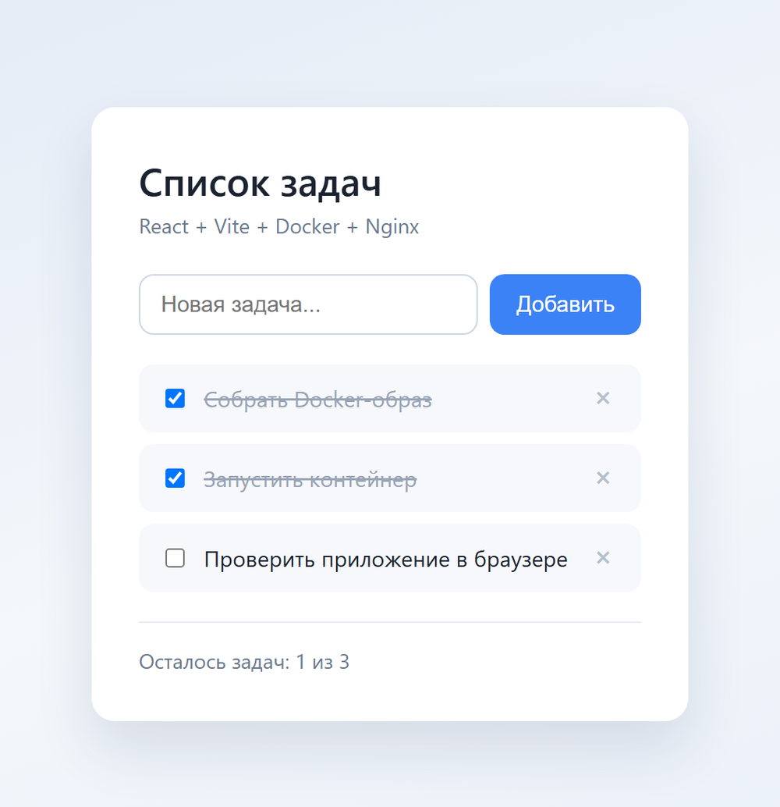

# ToDo-приложение на React в Docker

Минимальное, но полностью рабочее React-приложение — список задач. Проект собран по схеме
**многоступенчатой сборки**: сначала статика собирается на `node:alpine`, затем раздаётся
веб-сервером `nginx:alpine`. Итоговый образ — около **26 МБ**, в нём нет ни `node_modules`,
ни исходников, ни dev-зависимостей.

## Стек

| Технология | Роль |
|---|---|
| React 19 | интерфейс списка задач |
| Vite 7 | сборка и dev-сервер |
| Docker | упаковка приложения в контейнер |
| Nginx (alpine) | раздача статики в production |
| docker compose | запуск одной командой |

## Скриншот



## Возможности приложения

- добавление задачи;
- отметка задачи выполненной (чекбокс);
- удаление задачи;
- счётчик оставшихся задач;
- заголовок приложения можно задать при сборке образа.

## Структура проекта

```
.
├── Dockerfile            # production: node -> nginx (2 этапа)
├── Dockerfile.dev        # разработка: node + vite dev-сервер
├── nginx.conf            # конфигурация nginx (SPA, gzip, кэш)
├── docker-compose.yml    # запуск одной командой
├── .dockerignore         # что не попадает в контекст сборки
├── .env.example          # пример переменной окружения
├── index.html
├── package.json
├── vite.config.js
├── docs/
│   └── app.png           # скриншот для README
└── src/
    ├── main.jsx
    ├── App.jsx           # компонент списка задач
    ├── App.css
    └── index.css
```

## Сборка Docker-образа

```bash
docker build -t todo-app .
```

Собрать с другим заголовком приложения:

```bash
docker build --build-arg VITE_APP_TITLE="Мой список задач" -t todo-app .
```

## Запуск контейнера

```bash
docker run -d -p 8080:80 --name todo-app todo-app
```

Приложение открывается по адресу **http://localhost:8080**
(8080 — порт на компьютере, 80 — порт внутри контейнера).

## Запуск через docker compose

```bash
docker compose up -d
```

Остановить и удалить:

```bash
docker compose down
```

## Режим разработки (контейнер с горячей перезагрузкой)

```bash
docker build -f Dockerfile.dev -t todo-app:dev .
docker run -d -p 8080:3000 -v "D:/путь/к/проекту:/app" -v /app/node_modules --name todo-dev todo-app:dev
```

Папка проекта монтируется внутрь контейнера, поэтому изменения в файлах сразу видны
dev-серверу Vite — пересобирать образ не нужно.

## Переменные окружения

Заголовок приложения задаётся переменной `VITE_APP_TITLE`:

```bash
cp .env.example .env
```

или передаётся аргументом сборки (`--build-arg VITE_APP_TITLE="..."`).

## Как устроена сборка

1. **Этап `builder`** (`node:22-alpine`): копируются `package*.json`, выполняется `npm ci`,
   затем копируется исходный код и запускается `npm run build`. На выходе — папка `dist`.
2. **Этап `production`** (`nginx:alpine`): из первого этапа копируется только `dist`
   в `/usr/share/nginx/html`, плюс свой `nginx.conf`.

Поэтому в финальный образ не попадают исходники и зависимости — он весит 26 МБ вместо 324 МБ
у dev-образа.

`nginx.conf` включает:

- `try_files $uri $uri/ /index.html` — корректная работа клиентского роутинга;
- `gzip` — сжатие текстовых файлов;
- `expires 1y` + `Cache-Control: public, immutable` — кэширование статики с хешем в имени.

## Запуск без Docker (локально)

```bash
npm install
npm run dev      # http://localhost:3000
npm run build    # production-сборка в папку dist
```

## Полезные команды

```bash
docker ps                      # запущенные контейнеры
docker images todo-app         # образы приложения
docker logs todo-app           # логи nginx
docker stop todo-app           # остановить
docker rm todo-app             # удалить контейнер
docker rmi todo-app            # удалить образ
```
